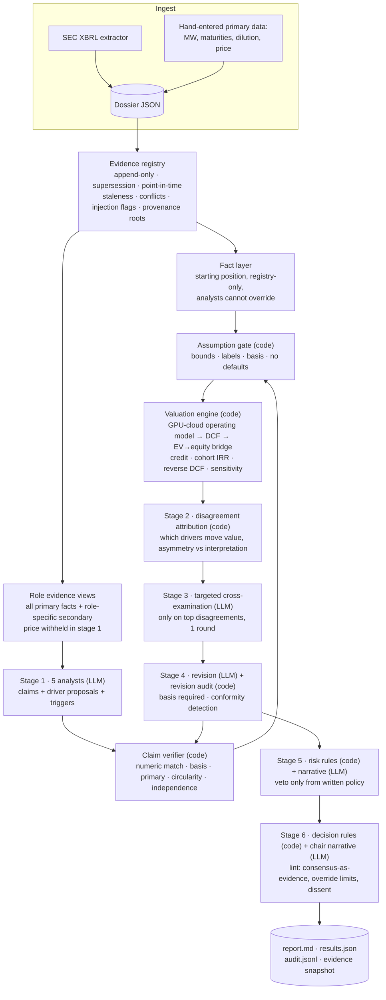

# Architecture

## Principle

**LLMs interpret, propose and critique. Code verifies, gates and computes.** Anything that can move a number is a
typed object with provenance. Free text is narrative only and never reaches the valuation engine.

## Flow

## Modules

| Module | Responsibility | LLM? |
|---|---|---|
| `schemas.py` | Typed records: Evidence, DataPoint, Claim, Assumption, ScenarioSpec, AnalystReport, ValuationResult, Disagreement, Challenge, Revision, RiskReview, Decision | – |
| `evidence/registry.py` | Append-only store; supersession; point-in-time visibility; staleness by source kind; conflict detection and primary-over-secondary resolution; provenance roots; snapshot hash | No |
| `evidence/verify.py` | Claim verdicts (15 kinds); pluggable `SupportJudge` for qualitative entailment | No (judge optional) |
| `evidence/sanitize.py` | Injection heuristics; fencing retrieved text as inert data | No |
| `valuation/drivers.py` | Driver catalogue: units, bounds, fact vs forecast | – |
| `valuation/model.py` | Operating model, DCF, equity bridge, credit projection, unit economics | No |
| `valuation/gate.py` | Fact layer; the only door into the model | No |
| `valuation/analysis.py` | Sensitivity, reverse DCF, disagreement attribution | No |
| `llm/` | Structured calls: cache, retries with backoff, timeouts, schema repair, cost log; fixture / OpenAI / Anthropic transports | – |
| `agents/` | Role specs, LLM output schemas, prompt builders | – |
| `pipeline/committee.py` | Six-stage orchestration | Calls LLMs |
| `risk/rules.py` | Pooled distribution, rule evaluation, implied views | No |
| `reporting/markdown.py` | Decision-first report with full audit trail | No |
| `ingest/sec.py` | XBRL → per-filing evidence | No |
| `eval/harness.py` | Adversarial suite, reproducibility, consistency, debate and flaw metrics | No |

## Which of the seven seats need an LLM?

| Seat | Verdict | Why |
|---|---|---|
| Five analysts | **LLM** | Interpreting evidence and proposing assumptions is the part that needs judgement. |
| Disagreement identification | **Code** | "Which assumption drives the value gap" is arithmetic. An LLM would guess at what code can compute exactly. |
| Risk manager | **Code rules + LLM commentary** | Vetoes must be reproducible and auditable, so they come from a written policy. The LLM adds risks the model does not capture. |
| Chair | **Code numbers + LLM narrative** | Range, expected return, rule-based recommendation and dissent are computed. The LLM writes the thesis and triggers; overrides are constrained and flagged. |

**Credit seat, honestly:** most of its quantitative output (coverage, leverage path, refinancing) is computed by
`credit_projection`. Its LLM value is in reading covenant and structure details that the model doesn't capture. If
live runs show it adds nothing beyond the computed metrics, fold it into the risk manager.

## Defences against multi-agent failure modes

| Failure | Defence | Status |
|---|---|---|
| Correlated reasoning (same model) | Per-role model config (`ICOMMITTEE_MODEL_<ROLE>`), distinct evidence views, report warns when all analysts share a model | Implemented; effectiveness unmeasured |
| False consensus | Dissent table; `decision_held_by_no_analyst` flag; chair cannot cite agreement as evidence | Implemented |
| Confirmation bias | Mandatory invalidation triggers; contrarian seat; cross-exam targets the specific driver | Partial |
| Anchoring on price | Price withheld in stage 1; dilution uses intrinsic, not market, price; reverse DCF only after independent valuation | Implemented |
| Hallucinated data | Structured quantitative claims verified numerically; facts only from registry; no defaults | Implemented |
| Circular citations | Provenance roots; committee-generated material marked `committee:` | Implemented |
| Repeated claims as independent | `derived_from` chains; independent-root count per claim | Implemented |
| Unproductive loops | One cross-exam round on ≤3 disagreements; bounded call count (≈21) | Implemented |
| Arbitrary confidence scores | Removed. Analysts give scenario probabilities and measurable triggers, which can later be scored | Implemented |
| Cost and latency | Disk cache, bounded calls, token and cost logging | Implemented |
| Overfitting to history | Point-in-time registry (no look-ahead) enables honest backtests | Foundation only |
| Social conformity | Changes need a basis; moves toward the median without new evidence are flagged | Detection only |

## Key tradeoffs

- **One-at-a-time attribution vs Shapley values.** One-at-a-time costs N×D valuations and is easy to explain; it
  ignores interactions, so the residual is reported. Shapley would cost 2^D. Revisit if residuals are routinely large.
- **Downgrade vs reject mislabelled assumptions.** The default keeps the value but relabels it `analyst_assumption`
  with a visible warning. `ICOMMITTEE_STRICT_GATE=1` rejects instead. Contradicted bases are always rejected.
- **Diverse evidence views.** These reduce correlated reasoning, but create disagreements from information
  asymmetry rather than interpretation. The system labels which is which, so the debate can resolve asymmetry
  quickly.
- **Annual model.** Annual periods are too coarse for quarterly energisation tracking, but keep the model auditable.
  Go quarterly only when a specific question needs it.
